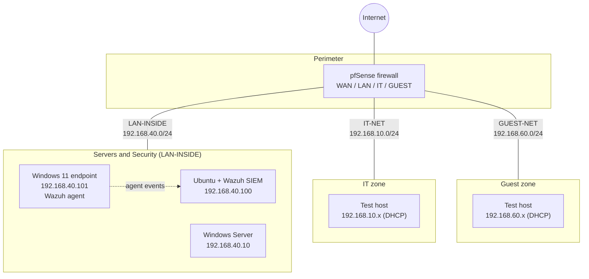

# Enterprise Network Security & SOC Lab

> A segmented, enterprise-style lab where I built the network, enforced security boundaries with a firewall, monitored endpoints with a SIEM, investigated traffic at packet level, and then deliberately broke it all to practise troubleshooting.

    

**Who this is for:** hiring managers and engineers who want to see how I think, not just what I clicked. Every section below links to a write-up with the evidence: commands, root causes, fixes and screenshots.

---

## Why I built this

I have six years of hands-on IT infrastructure and SAN/storage experience, and I am moving into security operations. I built this lab to prove the transition with real work rather than certificates alone. It covers the skills a SOC analyst or infrastructure security engineer uses every day:

- Understand how traffic actually flows (VLANs, routing, DNS, DHCP, ARP, TCP).
- Control that traffic with a firewall and verify the controls really work.
- Detect and investigate activity with a SIEM and Windows security logs.
- Troubleshoot methodically when things break.

---

## Project summary

| Area | What I did |
|---|---|
| **Network design** | Designed a six-segment enterprise network (IT, HR, Finance, Servers, Security, Guest) with VLANs and subnets in Cisco Packet Tracer. |
| **Switching and routing** | Configured access ports, trunks and inter-VLAN routing, then broke and fixed each one. |
| **Virtual security lab** | Built pfSense, Windows 11, Windows Server and Ubuntu VMs in VirtualBox. |
| **Firewall segmentation** | Wrote and tested three policy rules on pfSense: IT → Servers allow, Guest → Internal deny, Security → required systems allow. |
| **SIEM and endpoint monitoring** | Deployed Wazuh, enrolled a Windows endpoint, and investigated Windows security events (4624, 4625, 4688). |
| **Packet analysis** | Captured and analysed ARP, DNS, DHCP, ICMP, TCP, UDP, HTTP/HTTPS and SMB traffic in Wireshark. |
| **Troubleshooting** | Reproduced ten faults across the simulated and virtual networks, each documented as symptom, diagnosis, root cause, fix and verification. |

---

## Architecture



The diagram image is also saved at [`architecture/network-diagram.png`](architecture/network-diagram.png).

**Design notes**
- The Packet Tracer topology models the full six-VLAN enterprise design (VLANs 10-60) for switching and routing practice.
- The VirtualBox lab uses real systems for security work. pfSense has separate interfaces for the IT and Guest zones, because traffic between two hosts on the same subnet never reaches the firewall, so rules written on a single flat LAN could not be tested. Separate interfaces make every rule provable.

### Firewall policy

| # | Interface | Action | Source | Destination | Purpose |
|---|---|---|---|---|---|
| 1 | IT | Allow | IT hosts | Servers | IT staff can reach servers |
| 2 | Guest | Block | Guest hosts | Internal networks | Guests are isolated from internal systems |
| 3 | LAN | Allow | Wazuh manager | Internal networks | Security tooling can reach what it monitors |

All rules are logged, and anything not explicitly allowed on the IT and Guest interfaces falls through to the implicit deny.

---

## Skills demonstrated

**Networking**
- IPv4 addressing and subnetting, DHCP, DNS, ARP, ICMP, default gateways
- VLANs, access and trunk ports, inter-VLAN routing, static routes
- TCP three-way handshake, TCP vs UDP, common service ports (SMB 445, HTTPS 443)

**Network security**
- Network segmentation and zone-based firewall design
- pfSense rules, aliases, rule ordering, logging and verification
- Implicit deny behaviour and firewall log analysis
- Backing up configuration before making risky changes

**Security operations**
- Wazuh SIEM deployment and Windows agent enrolment
- Windows Event ID analysis: 4624 (logon), 4625 (failed logon), 4688 (process creation)
- Generating controlled failed-login events and investigating source, user, host, time and attempt count
- Using SIEM agent status as a health signal

**Packet analysis**
- Wireshark capture and display filters (`dns`, `icmp`, `tcp.flags.syn == 1`, `ip.addr == x`)
- Following TCP streams, reading handshakes, resolving DNS and ARP exchanges

**Troubleshooting and documentation**
- Structured diagnosis: Symptom → Diagnostic commands → Root cause → Fix → Verification
- Cisco CLI: `show vlan brief`, `show interfaces trunk`, `show ip route`, `show mac address-table`
- Windows tooling: `ipconfig /all`, `route print`, `nslookup`, `Test-NetConnection`
- Snapshots, config backups and change discipline

**Tools:** pfSense, Wazuh, Wireshark, Cisco Packet Tracer, VirtualBox, Windows 11, Windows Server, Ubuntu Server, PowerShell, Git and GitHub

---

## Key write-ups

| Topic | Write-up |
|---|---|
| VLAN, trunk, zone and link faults | [`networking/vlan-troubleshooting.md`](networking/vlan-troubleshooting.md) |
| Routing faults | [`networking/routing-troubleshooting.md`](networking/routing-troubleshooting.md) |
| DNS failure diagnosis | [`networking/dns-troubleshooting.md`](networking/dns-troubleshooting.md) |
| Firewall rules, tests and rule-disabled fault | [`firewall/firewall-rules.md`](firewall/firewall-rules.md) |
| Wazuh installation | [`wazuh/installation.md`](wazuh/installation.md) |
| Wazuh agent deployment | [`wazuh/agent-deployment.md`](wazuh/agent-deployment.md) |
| Detections and Windows event analysis | [`wazuh/detections.md`](wazuh/detections.md) |
| DNS packet analysis | [`wireshark/dns-analysis.md`](wireshark/dns-analysis.md) |
| TCP handshake and stream analysis | [`wireshark/tcp-analysis.md`](wireshark/tcp-analysis.md) |
| ARP analysis | [`wireshark/arp-analysis.md`](wireshark/arp-analysis.md) |
| Packet Tracer topology and configs | [`packet-tracer/`](packet-tracer/) |

---

## Featured: break-and-fix troubleshooting

In the final phase I broke the live lab on purpose, five different ways, and fixed each one by diagnosing it rather than guessing. Each was verified by re-testing, with before and after screenshots.

| Fault | What I broke | Symptom | How I diagnosed it | Root cause |
|---|---|---|---|---|
| **A. Wrong zone** | Moved a host onto the Guest network | Port 445 to the server timed out | `ipconfig`, `Test-NetConnection`, pfSense firewall log, alias review | Host landed in a zone covered by the Guest deny rule |
| **B. Wrong gateway** | Set a non-existent default gateway | Local pings worked, internet failed | `ipconfig /all`, `route print` | Default route pointed at a dead address |
| **C. DNS failure** | Pointed the client at an invalid DNS server | Names failed, IP pings worked | `nslookup`, `ipconfig /all` | Resolver unreachable, routing was fine |
| **D. Firewall rule disabled** | Disabled the IT → Servers allow rule | Previously working connection was blocked | pfSense firewall log, rule list | Traffic fell through to implicit deny |
| **E. Link down** | Disconnected pfSense's LAN adapter | Gateway unreachable, same-subnet traffic still worked | Ping tests, pfSense interface status | Virtual cable down on the gateway interface |

### A real-world lesson from this lab
Getting the zone test to work in the first place took proper troubleshooting. Traffic from the IT zone to my Windows Server failed even though the pfSense rule looked correct. Working through it, I found three separate causes:
1. The firewall alias held the wrong server IP (it was copied from a template, not from the real host).
2. The server had no route back to the other subnet, so replies had nowhere to go.
3. The server's own Windows firewall only accepted SMB from its local subnet.

Fixing each one in turn is a good reminder that "the firewall rule is right" and "the connection works" are different statements, and that return paths and host firewalls matter as much as the perimeter.

---

## Repository structure

```text
enterprise-network-security-lab/
├── README.md
├── architecture/
│   └── network-diagram.png
├── packet-tracer/
│   ├── topology.pkt
│   └── configurations.txt
├── networking/
│   ├── vlan-troubleshooting.md
│   ├── routing-troubleshooting.md
│   └── dns-troubleshooting.md
├── firewall/
│   └── firewall-rules.md
├── wazuh/
│   ├── installation.md
│   ├── agent-deployment.md
│   └── detections.md
├── wireshark/
│   ├── dns-analysis.md
│   ├── tcp-analysis.md
│   └── arp-analysis.md
└── screenshots/
```

---

## How I work

- **Change safely:** config backups and VM snapshots before every risky change.
- **Prove it:** every fix is verified by re-testing, never assumed.
- **Write it down:** each issue is documented with symptom, commands, cause, fix and verification so someone else can follow it.

---

## What's next

This lab is the foundation for **Project 2: SOC Incident Response and Network Forensics**, built on the same VMs. It adds an Active Directory domain, file-change monitoring and safe, simulated attack scenarios (failed logins, PowerShell activity, suspicious DNS and mass file changes) for detection and investigation.

---

## Safety and scope

This is an isolated lab on my own systems. All security events were generated by me, in a controlled environment, for detection and learning. No real malware was used.

## Contact

**[Your name]** · [LinkedIn](https://www.linkedin.com/in/your-profile) · [GitHub](https://github.com/your-username)
